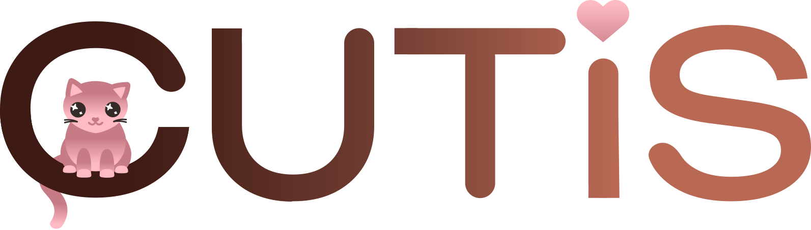

# NHNs component library

**This repository contains the NHN summer-student project "Cutis - the component library" by Malin Lenz Litlehei and Eline Lædre.**

---

## Coming soon

This repository _will_ contain React components in NPM packages that implement the design:

- @norskhelsenett/cutis

#### Using the React components

In your project:

```sh
npm i @norskhelsenett/cutis --save
```

Using components: (example from Helsenorge's Frankenstein design system)

```tsx
import Button from '@helsenorge/designsystem-react/components/Button';

const ExampleComponent: React.FC = () => {
  return <Button>{'Click me'}</Button>;
};
```

#### Documentation

View our [Storybook](https://www.youtube.com/watch?v=dQw4w9WgXcQ) to see all components and their props.

**Making a new component in @NorskHelsenett/cutis**

```sh
npm i
cd riktig mappe  # TODO: specify correct folder when possible
npm run new      # Follow the instructions
```

Use `npm run start` to start Storybook and start developing your component!

### Issues and pull requests

Please [file an issue on Github](https://github.com/NorskHelsenett/cutis) or open a pull request there.

If you have access to Norsk Helsenett's Slack, contact the [Cutis team](https://www.youtube.com/watch?v=dQw4w9WgXcQ) for assistance.